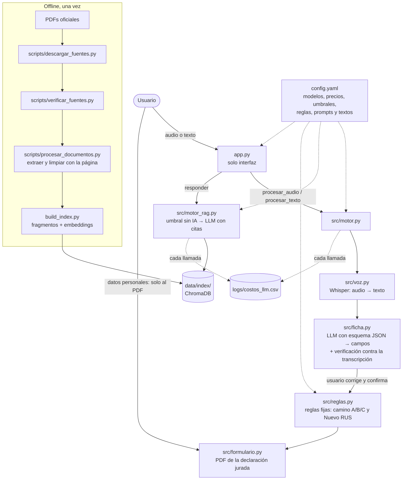

# Formalízate

> **Todos los datos de ejemplo de este repositorio son inventados**: el audio de prueba, la «Bodega Doña Rosa», los nombres, los DNI (`00000000`), los teléfonos y los correos. Ningún dato personal real se usó en el desarrollo ni en las pruebas.

## 1. One-liner

**Ayudamos a bodegueros y pequeños emprendedores del Perú a formalizarse: cuentan su negocio en un audio y reciben qué trámites les tocan, con la ley citada, y la declaración jurada de su licencia ya llena.**

## 2. Founder

**Michelle Li** — estudiante de Economía en la Universidad del Pacífico.

**Por qué este problema:** en Economía la informalidad aparece una y otra vez como uno de los
grandes frenos del Perú: los negocios informales no acceden a crédito formal, no pueden venderle
a empresas ni al Estado, y quedan fuera de la protección y los programas públicos. Lo que me llamó
la atención es que, para un negocio pequeño, muchas veces la barrera no es el costo del trámite,
sino la información: saber qué le toca, en qué orden y con qué documentos. Ese es un problema que
la tecnología sí puede resolver.

**Por qué soy la persona indicada:** combino la mirada económica del problema (incentivos,
costos de cumplir con la formalidad, quién gana cuando un negocio se formaliza) con lo que
construí en este curso. Ya había desarrollado un asistente RAG sobre normas de contrataciones
públicas, que es la base del motor legal de Formalízate: sé cómo hacer que una IA responda solo
con lo que dice la ley, cite la página y diga "no está en mis fuentes" cuando no sabe.

## 3. Problema

Un bodeguero que quiere formalizarse tiene que entender, sin ayuda, normas escritas para abogados: la Ley General de Bodegueros (Ley 30877) y su reglamento, la Ley Marco de Licencia de Funcionamiento (TUO de la Ley 28976) y los regímenes de SUNAT. Además, tiene que llenar formularios municipales. Hay que responder preguntas que parecen simples y no lo son:

- ¿Mi bodega califica para la **licencia provisional gratuita** o necesito la licencia de funcionamiento normal? Depende de cuatro condiciones: área, vivienda, piso y acceso a la calle.
- ¿Cuánto le pago a SUNAT? Depende de las **ventas y las compras** del mes, no solo de las ventas.
- ¿Qué formulario lleno, y qué casillas son mías y cuáles llena la municipalidad?

PRODUCE estima que la Ley General de Bodegueros alcanza a [más de 500 mil bodegas en el país](https://www.gob.pe/institucion/produce/noticias/154681-produce-reglamento-de-la-ley-general-de-bodegueros-impulsara-el-negocio-desarrollado-por-mas-de-500-mil-bodegas-en-el-pais).

**Lo que dijeron los usuarios (3 entrevistas, guía en [docs/research/guia_entrevistas.md](docs/research/guia_entrevistas.md)):**

> **TODO Michelle:** resumen de las 3 entrevistas (`docs/research/entrevista-01.md` a `-03.md`): perfil, qué les cuesta hoy, una frase literal de cada una y qué cambió en el producto por lo que dijeron.

## 4. Solución e insight

**Solución.** Una app en tres pasos y un chat:

1. **Cuéntame:** el usuario habla (o escribe) sobre su negocio, sin decir su nombre ni su DNI.
2. **Revisa tus datos:** la IA ordena lo que dijo en una ficha. Cada dato muestra **la frase exacta de la transcripción** de donde salió y su estado:
   - ✅ verificado;
   - ⚠️ por confirmar;
   - ➖ no mencionado.
3. **Tu plan:** reglas fijas (no la IA) deciden:
   - el **camino** (A: bodega con licencia provisional; B: negocio con local, con licencia de funcionamiento; C: sin local);
   - el **Nuevo RUS**;
   - un **checklist con su fuente** (documento y página).

   Con eso se genera en PDF la **declaración jurada que corresponde**, ya llena.
4. **Chat de dudas:** responde solo con las normas oficiales indexadas, citando documento y página, y se abstiene si la respuesta no está ahí.

**Insight.** El usuario no necesita un abogado ni un chatbot que «sepa de leyes». Necesita **que alguien le ordene lo que ya sabe de su propio negocio** (metros, piso, ventas) y lo cruce con reglas que son fijas. Por eso la IA solo transcribe, ordena y explica; **nunca decide ni inventa**:

- Un dato solo queda verificado si su frase aparece en lo que dijo el usuario.
- Los tres datos que cambian el trámite siempre los confirma el usuario con un clic.
- El camino y el régimen los decide código Python con la fuente legal al lado.
- En una declaración **jurada**, el que firma es el usuario: la app nunca llena lo que le toca decidir a él ni a la municipalidad (casillas, nivel de riesgo, CIIU, zonificación).

## 5. Why now

- **La ley acaba de abrir el trámite simple.** La Ley 31866 (11/08/2023) y el D.S. 003-2024-PRODUCE (15/02/2024) establecen que la licencia provisional de bodegas se otorgue de forma **virtual, automática, gratuita y por única vez**. El trámite ya es simple; lo difícil es saber si te corresponde y llenar bien la declaración.
- **La voz a texto y los LLM ya son baratos y entienden español peruano coloquial.** Una sesión completa cuesta **US$ 0.0037 (S/ 0.013)** de IA (ver la sección 7). Se puede atender a miles de bodegueros por pocos dólares.
- **Hablar es más fácil que llenar un formulario** para quien atiende una bodega todo el día.

## 6. Demo

**URL pública:** <https://formalizate.streamlit.app/#formaliza>
**Video de respaldo (60–90 s):** **TODO Michelle:** pegar el link.

### Capturas

> **TODO Michelle:** reemplazar estos tres espacios por capturas guardadas en `docs/capturas/`.

| 1. Cuéntame (con el aviso de privacidad) | 2. Revisa tus datos (estados y citas) | 3. Tu plan (camino, checklist citado y PDF) |
|---|---|---|
| `docs/capturas/1_cuentame.png` | `docs/capturas/2_revisa.png` | `docs/capturas/3_plan.png` |

### Cómo correrlo en local

Probado con Python 3.14 en macOS. El índice ya viene en el repo (`data/index/`): no hace falta construirlo.

```bash
git clone https://github.com/mmlis02/Formalizaci-n-de-MYPES.git
cd Formalizaci-n-de-MYPES
python3 -m venv .venv && source .venv/bin/activate
pip install -r requirements.txt
cp .env.example .env              # y escribe tu clave después de OPENAI_API_KEY=
git config core.hooksPath .githooks   # activa el pre-commit que bloquea claves y .env
streamlit run app.py
```

Otros comandos:

| Comando | Qué hace | ¿Cuesta? |
|---|---|---|
| `python -m pytest` | 64 pruebas (normalización, verificación, reglas por camino, PDF, motor) | No: usan un cliente falso |
| `python preguntar.py "¿Hasta qué tamaño puede ser mi bodega?"` | Chat de dudas en la terminal | Centavos |
| `python scripts/probar_ficha.py tests/datos/audio_sintetico.m4a` | Audio → ficha → diagnóstico en la terminal | ~US$ 0.0025 |
| `python scripts/prueba_demo.py` | Flujo completo real antes de presentar (ficha → camino A → PDF → pregunta con cita → abstención), con ✅/❌ por paso y costo total | ~US$ 0.0004 |
| `python -m eval.evaluar_ficha` | Evaluación de la ficha con 8 casos inventados, 2 corridas cada uno | ~US$ 0.004 |
| `python scripts/costo_por_usuario.py` | Costo de una sesión típica desde `logs/costos_llm.csv` | No |
| `python -m eval.evaluar_recuperacion` y `python eval/barrido_umbral.py` | Recall@k y barrido del umbral | Centavos (embeddings) |
| `python scripts/descargar_fuentes.py` → `verificar_fuentes.py` → `procesar_documentos.py` → `python build_index.py` | Rehacer el corpus y el índice desde cero | Centavos (embeddings) |

### Arquitectura



Reglas de arquitectura que se cumplen:

- `app.py` solo es interfaz: llama a `src/motor.py` y `src/motor_rag.py`, y ningún archivo de `src/` importa Streamlit. Se comprueba con este comando, que no devuelve nada:
  ```bash
  grep -rn streamlit src/
  ```
- Todo lo configurable está en [config.yaml](config.yaml): modelos, precios con fecha de verificación, umbral, reglas con su fuente, prompts y textos de la interfaz.
- La clave vive en `.env` (local) o en los *secrets* de Streamlit Cloud, nunca en git. El hook [.githooks/pre-commit](.githooks/pre-commit) bloquea commits con claves o con `.env`. Revisé el historial completo con `git log -p | grep -iE "api_key|secret|token|sk-"`: solo aparecen nombres de variables, y no hay ninguna cadena con formato de clave.

### Modelos y APIs (y por qué)

| Para qué | Modelo / API | Por qué |
|---|---|---|
| Voz a texto | **Whisper (`whisper-1`)**, API de OpenAI, US$ 0.006/min | Es la herramienta de la sesión 13. Con un *prompt* de vocabulario («bodega, RUC, jirón…») corrige errores típicos («Girón» → jirón, «rug» → RUC). Figura como *deprecated* en la página de OpenAI pero sigue respondiendo; si se retira, se cambia `voz.modelo` en el config. |
| Ficha del negocio y respuestas del chat | **`gpt-6-luna`** con salidas estructuradas (`json_schema` estricto), sin razonamiento oculto | Costo bajo y predecible (US$ 0.10 / 0.50 por 1M tokens de entrada/salida) y JSON siempre válido. El mismo modelo de mi HW_03. |
| Embeddings del RAG | **`text-embedding-3-small`** (US$ 0.02 por 1M tokens) | Funciona por API, sin `torch`: el despliegue en Streamlit Cloud queda liviano. El índice entero costó US$ 0.0015. |
| Índice vectorial | **ChromaDB** persistente en `data/index/` | El mismo de HW_03. Va en el repo porque el servidor no lo construye. En Streamlit Cloud se usa `pysqlite3-binary` si el SQLite del sistema es viejo. |
| PDF | **reportlab** | Arma el formato con las mismas secciones y casillas del oficial. |
| Números en palabras | **text2num** (`alpha2digit`) | «cuatro mil quinientos» → 4500, antes de verificar. |

Precios verificados el 16/11/2026 en la [página de precios de OpenAI](https://developers.openai.com/api/docs/pricing).

### Corpus: solo fuentes oficiales

9 documentos (gob.pe, El Peruano y SUNAT), descargados con fecha y SHA-256 en [data/manifiesto_descargas.json](data/manifiesto_descargas.json):
- Ley 30877 y su modificatoria, la Ley 31866;
- el Reglamento (D.S. 010-2020-PRODUCE) y su modificatoria (D.S. 003-2024-PRODUCE);
- el TUO de la Ley 28976, actualizado al 20/09/2024;
- los formatos TUPA de bodegas y de riesgo bajo;
- dos guías de orientación de SUNAT de 2020.

Antes de indexar se verificó cada fuente: páginas, caracteres por página, páginas sin texto y orden de lectura. La tabla está en [data/processed/verificacion_fuentes.md](data/processed/verificacion_fuentes.md).
- **Descartados o reemplazados:** el PDF del D.S. 010 en gob.pe es un escaneo sin texto (se usó el de El Peruano), y la charla de SUNAT que pedía el plan da error 404 (se reemplazó por las dos guías de SUNAT, aprobadas por Michelle).
- Cuando el chat cita material de SUNAT, agrega una nota de que es de 2020.

### Resultados de la evaluación

[eval/preguntas.csv](eval/preguntas.csv) tiene 20 preguntas: 15 dentro del corpus, de las cuales 5 están dichas como las diría un bodeguero, y 5 fuera del corpus.

**Recuperación** (527 fragmentos de 500 caracteres con solape de 150, `text-embedding-3-small`):

| Recall@1 | Recall@3 | Recall@5 | MRR@5 |
|---|---|---|---|
| 0.667 | 0.933 | 1.000 | 0.791 |

**Umbral de abstención sin IA: 0.474.** Es la similitud de la pregunta legítima más baja (D05, «un pan de 50 céntimos», 0.4793) menos 0.005. Es la misma regla de HW_03:

| Umbral | Fuera del corpus detenidas sin IA | Del corpus detenidas por error | Fuera que pasan a la IA |
|---|---|---|---|
| 0.450 | 1 de 5 | 0 de 15 | 4 |
| **0.474 (elegido)** | **1 de 5** | **0 de 15** | **4** |
| 0.480 | 1 de 5 | 1 de 15 | 4 |
| 0.490 | 3 de 5 | 1 de 15 | 2 |
| 0.540 | 5 de 5 | 1 de 15 | 0 |

Cuatro preguntas fuera del corpus (Indecopi, caja municipal, CTS y DIGESA) se parecen más al corpus que D05, así que ningún umbral las detiene sin perder una pregunta legítima. Las cuatro las detiene la **segunda defensa**: el LLM revisa los fragmentos y marca `fuera_de_corpus`. Lo comprobé con el motor completo. Detalle en [eval/resultados/puntajes_top1_oai3small_c500_s150.md](eval/resultados/puntajes_top1_oai3small_c500_s150.md).

**Ficha del negocio.** [eval/casos_ficha.yaml](eval/casos_ficha.yaml) tiene 8 descripciones escritas con datos inventados, cada una con el valor correcto de cada campo:
- bodegas que cumplen y que no cumplen (por área, y por estar fuera de la vivienda, en un tercer piso y sin puerta a la calle);
- una peluquería y una venta por Instagram;
- números en palabras, montos como «S/ 9,500» y una persona que se corrige a mitad de frase.

Cada caso se corrió **2 veces** con `procesar_texto`, el mismo que usa la app:

| Campos | % correcto | % verificado | % por confirmar | % no mencionado | Verificado con valor incorrecto |
|---|---|---|---|---|---|
| Números (área, piso, ventas, compras) | 100 % | 94 % | 0 % | 6 % | 0 |
| Textos (giro, nombre, dirección, distrito, provincia, depto.) | 100 % | 52 % | 2 % | 46 % | 0 |
| Sí/no que deciden el camino (local, vivienda, acceso) | 100 % | 0 % | 92 % | 8 % | 0 |
| ¿Tiene RUC? | 100 % | 100 % | 0 % | 0 % | 0 |

> ⚠️ **8 casos son una muestra pequeña**, y los escribió el agente, no usuarios reales: sirven para ver patrones, no para afirmar que la ficha acierta siempre. La tabla por campo está en [eval/resultados/ficha_resumen.md](eval/resultados/ficha_resumen.md).

Cómo leer la tabla:
- **«No mencionado» es una respuesta correcta.** Cuando el texto no dice un dato (por ejemplo, la provincia), lo correcto es dejarlo vacío, y la IA no lo dedujo en ningún caso.
- **Los sí/no que deciden el camino nunca quedan verificados:** por diseño, siempre los confirma el usuario.
- **La IA dio el mismo valor en las dos corridas en los 112 campos.** En una evaluación anterior hubo 1 cambio: un distrito salió «Cercado de Arequipa» en una corrida y «Cercado» en la otra.
- **La persona que se corrige** («mide 40, no, perdón, 45») salió bien en las dos corridas. Pero la verificación no lo garantiza: comprueba que el valor esté en la cita, y esa cita contiene el 40 y el 45.
- **El camino preliminar acierta en 16 de 16 corridas.** La primera evaluación acertó en 14: las 2 que fallaron eran del mismo caso y no eran un error de la IA. La ficha decía «bodeguita», y la regla buscaba la palabra exacta «bodega» en el giro, así que no la reconocía como bodega y daba camino B en vez de A. Se agregó «bodeguita» a `palabras_giro` en `config.yaml`. Esto muestra para qué sirve la evaluación: encontró un error en las reglas, no en la IA.

## 7. Modelo de negocio

**Precio:** Gratis para el emprendedor. Pagan las municipalidades, que tienen metas de formalización: S/ 1,000 al mes por municipalidad, hasta 5,000 sesiones (costo de IA: unos S/ 65 al mes a S/ 0.013 por sesión). Segundo cliente posible: cajas municipales y fintech, que necesitan clientes con RUC para darles crédito. Hipótesis por validar con municipalidades.

**Costo por usuario.** Se calcula con las llamadas reales de `logs/costos_llm.csv` (`python scripts/costo_por_usuario.py`). Una sesión típica tiene 1 audio de ~30 s, 1 extracción de la ficha y 3 preguntas al chat. Supuesto conservador: las 3 preguntas llaman al LLM.

| Parte de la sesión | US$ | S/ | Cómo se calculó |
|---|---|---|---|
| Audio de 30 s (Whisper, US$ 0.006/min) | 0.00300 | 0.0104 | precio × duración |
| Extracción de la ficha (LLM) | 0.00022 | 0.0007 | promedio de 7 llamadas |
| 3 preguntas al chat (embedding + LLM) | 0.00046 | 0.0016 | promedio de 17 llamadas al LLM y 61 embeddings |
| **Total por sesión** | **0.0037** | **0.0127** | |
| Por 1,000 sesiones | 3.68 | 12.70 | |

Tipo de cambio: S/ 3.452 por US$ (venta SUNAT/SBS del 05/11/2026; está en `config.yaml > costo_por_usuario`). El 82 % del costo es el audio: si el usuario escribe en vez de hablar, la sesión cuesta ~US$ 0.0007. A esto falta sumar el hosting: Streamlit Community Cloud es gratis para el MVP.

## 8. Herramientas del curso

| Herramienta | Sesión | Dónde está |
|---|---|---|
| **Whisper (voz a texto)** | 13 | [src/voz.py](src/voz.py) (`transcribir`: revisa el archivo antes de llamar a la API) y [src/llm.py](src/llm.py) (`transcribir_audio`: llamada y costo por minuto) |
| **LLM con salidas estructuradas** | 08 | [src/ficha.py](src/ficha.py) (`esquema_ficha`: esquema JSON estricto con valor y cita por campo; `extraer_ficha` y `verificar_campo`) y [src/llm.py](src/llm.py) (`llamar_llm_json`) |
| **RAG con citas y abstención** | 08 | [src/motor_rag.py](src/motor_rag.py) (`responder`: umbral sin IA, `fuera_de_corpus` con IA y citas desde los metadatos), [build_index.py](build_index.py), [src/fragmentos.py](src/fragmentos.py), [src/indice.py](src/indice.py) y [eval/](eval/) |

El mapa del código, en el orden del flujo y con números de línea, está en [docs/mapa_codigo.md](docs/mapa_codigo.md).

## 9. Qué hizo el agente

El proyecto se construyó con Claude Code siguiendo [PLAN.md](PLAN.md) y [CLAUDE.md](CLAUDE.md), un bloque por vez y con un commit por paso.

**Lo que decidió Michelle:**
- La idea, el usuario, el plan de bloques y las reglas de arquitectura (PLAN.md, CLAUDE.md), y la guía de entrevistas.
- Ampliar el alcance de solo bodegas a los **caminos A, B y C**.
- Reemplazar la charla de SUNAT, que daba 404, por las dos guías de 2020, y que el chat avise su fecha cuando las cita.
- Aclarar que el formato del Anexo 1 es la copia publicada por la Municipalidad de Veintiséis de Octubre.
- Que los tres datos sí/no que deciden el camino **siempre los confirme el usuario** con un clic.
- El aviso de **no decir nombre ni DNI** en el audio.
- Dónde van `scripts/` y `tests/`, fijar las versiones por bloque, el despliegue en Streamlit Cloud y revisar cada paso antes de seguir.

**Lo que vino del HW_03 de Michelle** (copiado y adaptado; cada archivo lo dice en su docstring):
- `src/config.py`, `src/costos.py`, `src/llm.py`, `src/embeddings.py` (solo la versión por API), `src/extraccion.py`, `src/limpieza.py` (con reglas nuevas para Editora Perú y SUNAT), `src/fragmentos.py`, `src/indice.py`, `src/motor_rag.py` (el mismo motor con dos defensas; las notas de versión ahora salen del config) y `build_index.py`;
- los scripts de descarga, verificación, procesamiento y reporte, `eval/evaluar_recuperacion.py`, `eval/barrido_umbral.py`, `preguntar.py`;
- el hook pre-commit;
- la configuración de fragmentos (500/150), la regla del umbral y las versiones de los paquetes.

**Lo que generó el agente:**
- `src/voz.py`, `src/ficha.py` (con la regla de verificación valor + cita), `src/reglas.py`, `src/formulario.py`, `src/motor.py`, `app.py`, las 64 pruebas de `tests/`, `scripts/costo_por_usuario.py`, `scripts/prueba_demo.py` y `eval/evaluar_ficha.py`.
- **Los 8 casos de [eval/casos_ficha.yaml](eval/casos_ficha.yaml)** y su valor correcto de cada campo (datos inventados); Michelle debe revisarlos.
- Los textos y prompts de `config.yaml`, este README y `docs/mapa_codigo.md`.
- **Las 20 preguntas de evaluación.** Las redactó el agente, comprobando la página de cada respuesta en el corpus; Michelle debe revisarlas.
- La búsqueda de los enlaces oficiales que faltaban (Ley 30877, D.S. 010 en El Peruano, PDF de la Ley 31866 y el D.S. 003-2024, cuyo enlace del plan daba 404).
- El audio sintético de prueba (voz del sistema, datos inventados).

**Decisiones técnicas que tomó el agente y que conviene saber:**
- **Corrigió un error heredado de HW_03:** con solape, `fragmentos.py` no detectaba el artículo de algunos fragmentos. Por eso faltaba la nota «art. 19 modificado por el D.S. 003-2024». Recall@1 bajó de 0.733 a 0.667 con la corrección; se prefirió que las notas de versión fueran correctas.
- No afirma que el RUC sea gratuito, aunque lo dice el plan, porque ningún documento del corpus lo dice.
- En el Anexo 1 solo marca «Licencia de funcionamiento — Indeterminada», que es la regla general del art. 11 del TUO.
- Usa `whisper-1` aunque figura como *deprecated*, porque es el Whisper del curso y responde.
- Reutilizó la configuración de fragmentos de HW_03 sin volver a compararla con este corpus.

**Lo que falta (TODO Michelle):** notas de las 3 entrevistas, video y capturas; grabar `ejemplos/audio_ejemplo.m4a` (la app lo usará en lugar del audio sintético) y que 2 personas prueben la app.
