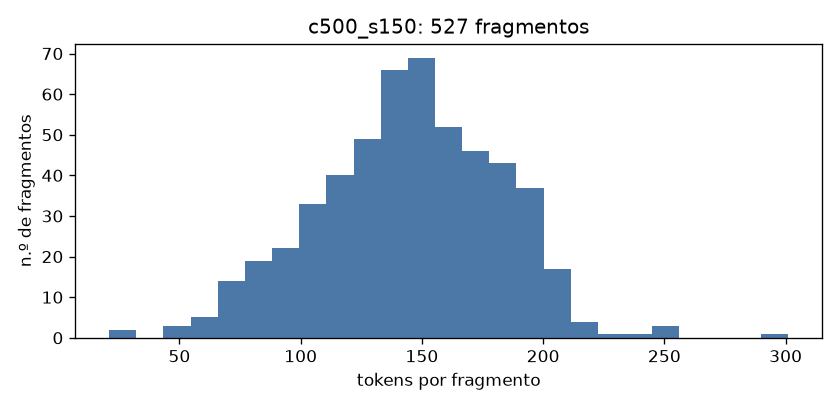

# Fragmentos e índice (Bloque 1, paso 5)

Modelo de embeddings: `text-embedding-3-small` (límite 8191 tokens). Configuración: **c500_s150** (tamaño 500 caracteres, solape 150).

Total: **527 fragmentos** (la colección tiene 527).

## Fragmentos por documento

| Documento | Fragmentos | Páginas | chars mín / mediana / máx |
|---|---|---|---|
| ley30877 | 20 | 2 | 194 / 466 / 636 |
| ley31866 | 7 | 1 | 399 / 487 / 644 |
| ds010_2020_produce | 90 | 6 | 42 / 441 / 649 |
| ds003_2024_produce | 22 | 2 | 194 / 470 / 648 |
| tupa_bodegas | 9 | 2 | 301 / 487 / 641 |
| tuo_ley28976 | 192 | 14 | 94 / 458 / 650 |
| tupa_riesgo_bajo | 13 | 2 | 260 / 439 / 636 |
| sunat_nuevo_rus | 61 | 9 | 18 / 425 / 648 |
| sunat_formalizar_negocio | 113 | 11 | 80 / 429 / 650 |

## Distribución de longitudes (todo el corpus)

| Medida | mín | mediana | p90 | máx |
|---|---|---|---|---|
| caracteres | 18 | 449 | 642 | 650 |
| tokens | 21 | 147 | 191 | 301 |

Fragmentos sobre el límite de 8191 tokens: **0**.
Tokens = lo que realmente ve el modelo: encabezado corto del documento + texto.

